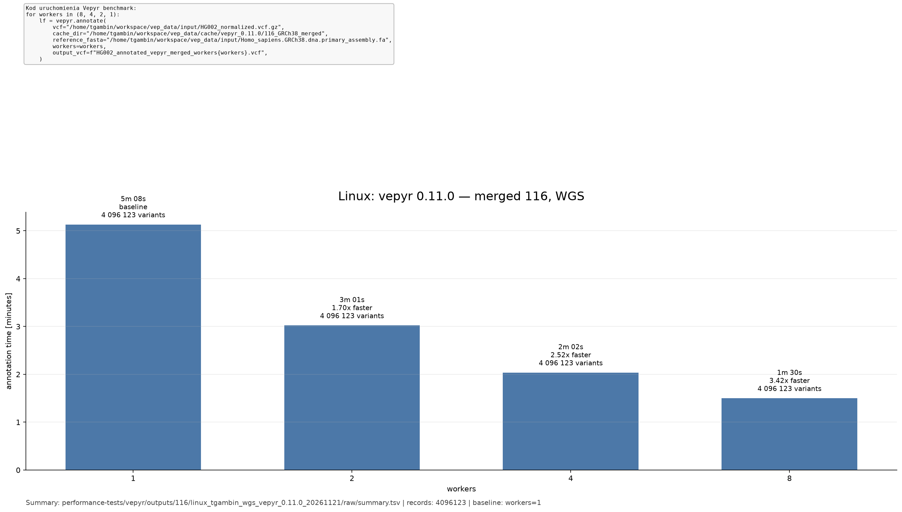

# Linux vepyr 0.11.0 merged worker scaling

> Superseded by [`linux_tgambin_wgs_vepyr_0.11.0_pr293`](../linux_tgambin_wgs_vepyr_0.11.0_pr293) (2026-11-23,
> median of three runs). In this set the process wall includes counting the 29.4 GB output's records
> (about 12 s per run; vepyr PR #293), and each worker count ran once.

Whole-genome HG002 GRCh38 measurements from 2026-11-21 with the merged
release-116 cache and 8, 4, 2 and 1 workers. Only vepyr was measured, with the
procedure of the macOS 0.11.0 set
([`macos_mwiewior_wgs_vepyr_0.11.0_20261121`](../macos_mwiewior_wgs_vepyr_0.11.0_20261121));
this is the Linux 0.11.0 re-run that the
[paper index](../../../../paper-0.11.0/README.md) lists as pending.

## Environment and inputs

- Ubuntu 22.04.3 LTS, Linux 6.8.0-138-generic, AMD Ryzen 9 5950X (16 cores,
  32 hardware threads), 62 GiB RAM, `schedutil` frequency governor; the host
  of the 0.9.0 and 0.10.0 sets. The desktop session and a browser stayed open;
  no other heavy work ran.
- vepyr 0.11.0 installed from the Linux x86-64 PyPI wheel
  (`cp310-abi3-manylinux2014_x86_64`), not compiled locally, in the isolated
  environment `venv/vepyr-0.11.0`.
- Python 3.12.8, PyArrow 24.0.0, Polars 1.44.2, the versions of the 0.10.0 set.
- Input: `HG002_normalized.vcf.gz`, 4,096,123 records, SHA-256
  `76931747a93b077464046236fb7357e0bc8ca8e4581e6f19a95c97334867965b`.
- Reference: `Homo_sapiens.GRCh38.dna.primary_assembly.fa`.
- Cache: `biodatageeks/vepyr_116_GRCh38_merged` at the revision pinned by
  vepyr 0.11.0, `ac2c8ad979ad063816368b0720e6e4501d64a3f3`. Against the 0.10.0
  pin (`5b83dd8d249106c6cc3f1c04c522b4bec716cc97`) only `transcript/` (1,869
  of 1,870 files, 332 MB) and `README.md` changed. `vepyr download-cache`
  fetched exon, motif, regulatory and transcript; translation_core,
  translation_sift and variation were copied from the local download of the
  0.10.0 pin, whose files huggingface_hub had all recorded at `5b83dd8`. A
  second `vepyr download-cache` into the same directory then hashed every
  copied file against the `ac2c8ad` etags and recorded it at that commit.
  All 7,697 downloaded files match the `ac2c8ad` tree in hash and size
  (`.gitattributes` and `README.md` are not downloaded by vepyr).
- Plain VCF output, `preserve_record_layout=True`.

Input, reference, cache, measured output and archive were all on the NVMe SSD
(`/dev/nvme0n1p5`, ext4); `run.sh` refuses to start otherwise. Nothing was
moved to the HDD.

## Procedure

`run.sh` calls the unchanged `performance-tests/vepyr/scripts/run_vepyr_worker_scaling.py`
of tag 0.11.0 once per worker count, with `VEPYR_EXPECTED_VERSION=0.11.0`:
one discarded run with 8 workers, then 8, 4, 2 and 1 workers, one run each.
After each run the record lines were checksummed per contig
(`raw/*.md5.json`), the output was deleted and the filesystem synchronised.
The checksum script is
`performance-tests/paper-0.11.0/engines-two-modes-20261120/scripts/contig_md5.cached-read.py`
(as of `ae3df1e`): the macOS set used `contig_md5.py`, which reads with
`F_NOCACHE`, and Linux has no such flag; the two differ in nothing else.

`raw/free_memory.csv` records `/proc/meminfo` before each run. Memory was not
released by force as on macOS: MemAvailable stayed at 59.5-59.7 GiB, and
about 29-30 GiB of file cache remained after each deleted output.
`raw/environment.txt` records the run parameters.

## Results

All five runs exited successfully and wrote exactly 4,096,123 records. One
measured run per worker setting, with no variability estimate; the discarded
8-worker run took 1:50.04 (98.8 s annotation), 8% (process) and 10%
(annotation) above the measured one.

| Workers | Process wall | Annotation only | CPU (user + sys) | Peak RSS |
|---|---|---|---|---|
| 1 | 5:19.77 | 308.0 s | 551 s | 3.3 GiB |
| 2 | 3:15.13 | 181.4 s | 529 s | 4.7 GiB |
| 4 | 2:16.75 | 122.3 s | 561 s | 5.0 GiB |
| 8 | 1:42.19 | 90.1 s | 668 s | 5.3 GiB |

The process wall time includes Python start-up, writing the 29.4 GB plain VCF
and the runner's count of the output records. Eight workers annotate 3.42x
faster than one.

At every worker count, the discarded run included, the MD5 of all record lines
(`157fca5b065c20eb7cec3e7a18ef28b7`) and the 22 per-contig checksums equal
those of the macOS 0.11.0 set, which equal the vepyr 0.11.0 output that matches
Ensembl VEP 116.0 record for record.

## Against Linux vepyr 0.10.0

Reference: `linux_vepyr_0.10.0_20261015` (on the branch `archive-pre-0.11.0`), same host, input, reference and
Python environment versions.

| Workers | Annotation 0.10.0 | Annotation 0.11.0 | Speed-up | Process wall 0.10.0 | Process wall 0.11.0 | CPU 0.10.0 | CPU 0.11.0 | Peak RSS 0.10.0 | Peak RSS 0.11.0 |
|---|---|---|---|---|---|---|---|---|---|
| 1 | 497.9 s | 308.0 s | 1.62x | 8:33.04 | 5:19.77 | 596 s | 551 s | 3.1 GiB | 3.3 GiB |
| 2 | 299.0 s | 181.4 s | 1.65x | 5:15.28 | 3:15.13 | 589 s | 529 s | 4.6 GiB | 4.7 GiB |
| 4 | 203.0 s | 122.3 s | 1.66x | 3:35.59 | 2:16.75 | 629 s | 561 s | 4.9 GiB | 5.0 GiB |
| 8 | 164.5 s | 90.1 s | 1.83x | 3:13.61 | 1:42.19 | 758 s | 668 s | 5.7 GiB | 5.3 GiB |

Annotation time fell by 38-45%, while CPU time fell by only 8-12%: 0.11.0
keeps more cores busy at every worker count (1.75 cores on average at one
worker against 1.17). The eight-worker scaling rose from 3.03x to 3.42x.

The two sets differ in procedure, so the comparison describes the two measured
setups, not an isolated engine change:

- 0.10.0 ran 1, 2, 4 and 8 workers without a warm-up and moved each output to
  the HDD, where it was compressed with `pigz` before the next run; 0.11.0 ran a
  warm-up and then 8, 4, 2 and 1 workers with everything on the SSD.
- The file cache state before each run was not recorded for 0.10.0.
- The cache revisions differ in the transcript entity only.

## Figure



The figure shows `annotation_seconds`. It was drawn by the unchanged plotter
from the repository root, with the arguments of the 0.10.0 figure; the plotter
builds the cache path of its caption from `DATA_VEPYR_DIR` and `RELEASE`, so
`RELEASE` names this run's cache directory:

```bash
DATA_VEPYR_DIR=/home/tgambin/workspace/vep_data RELEASE=vepyr_0.11.0/116 \
  .venv/bin/python performance-tests/vepyr/scripts/plot_vepyr_worker_scaling.py \
  --cache-type merged \
  --summary performance-tests/vepyr/outputs/116/linux_tgambin_wgs_vepyr_0.11.0_20261121/raw/summary.tsv \
  --expected-workers 1,2,4,8 \
  --title 'Linux: vepyr 0.11.0 — merged 116, WGS' \
  --output performance-tests/vepyr/outputs/116/linux_tgambin_wgs_vepyr_0.11.0_20261121/vepyr_0.11.0_merged_workers_1_2_4_8.png
```

## Artifacts

`raw/` holds `summary.tsv`, `free_memory.csv`, `environment.txt` and, per run,
`*.metrics.json`, `*.time.txt` and `*.md5.json`; `warmup_workers8.*` is the
discarded run. The VCF paths in `summary.tsv` and the metrics name the deleted
outputs. Generated VCFs and caches are not included in Git.

As for the other result sets of the paper, console logs are left out: the
console log of `run.sh` and each run's stderr (progress bars only) and stdout
(empty) are kept on the measurement machine at
`/home/tgambin/workspace/vep_data/archive/116/vepyr_merged_worker_scaling_v0110/console/`.

Measure again with `bash run.sh`; it rewrites `raw/`.
