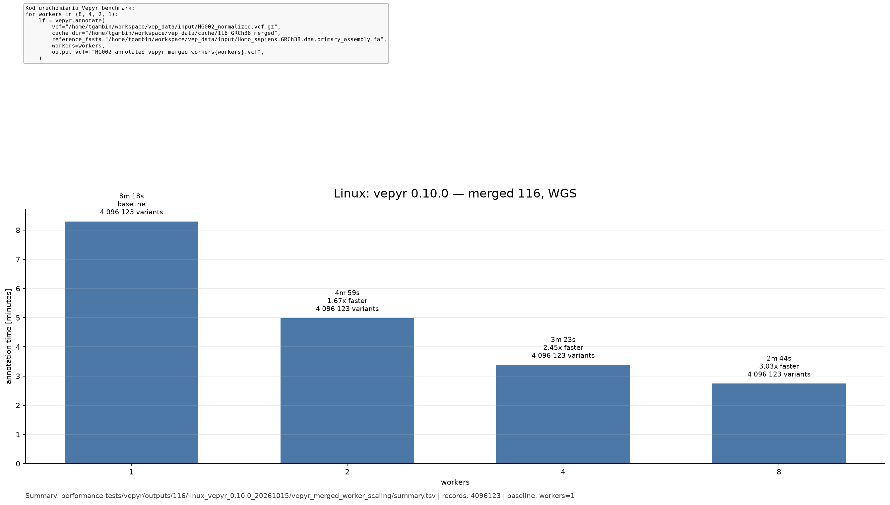

# Linux vepyr 0.10.0 merged worker scaling

Whole-genome HG002 GRCh38 measurements from 2026-10-15, using the merged
release-116 cache and workers 1, 2, 4 and 8. This result set contains merged
only; it does not include RefSeq or new Ensembl VEP measurements.

## Environment and inputs

- Ubuntu 22.04.3 LTS, Linux 6.8.0-138-generic, AMD Ryzen 9 5950X
  (16 cores, 32 hardware threads), 64 GB RAM.
- vepyr 0.10.0 installed from the Linux x86-64 PyPI wheel, not compiled locally.
- Python 3.12.8, PyArrow 24.0.0, Polars 1.44.2.
- Input: `HG002_normalized.vcf.gz`, 4,096,123 records.
- Reference: `Homo_sapiens.GRCh38.dna.primary_assembly.fa`.
- Cache: `biodatageeks/vepyr_116_GRCh38_merged` at the revision pinned by
  vepyr 0.10.0: `5b83dd8d249106c6cc3f1c04c522b4bec716cc97`.
  The cache was downloaded using the package's `vepyr download-cache` command
  and includes `reference_policy.json`.
- Plain VCF output, `preserve_record_layout=True`.

The existing benchmark scripts from commit
`b14bda3d4cf80c0f16d62ab371c28866ae589c33` were used without modifications.
The merged wrapper, worker-scaling runner, single-run benchmark and plotter
are byte-identical in the publication base,
`3f2152004c861bcc7e17279c47b895b6b05dedfe`.

`VEPYR_PYTHON` selected the isolated PyPI environment and
`VEPYR_EXPECTED_VERSION=0.10.0` guarded the imported version. The unchanged
`performance-tests/vepyr/scripts/run_vepyr_merged_worker_scaling.sh` was invoked
once per worker count, in the order 1, 2, 4, 8. Short merged and RefSeq smoke
tests passed before the full measurements.

Input, reference, converted cache and measured output were on NVMe. After
each measured process finished, the existing runner moved its VCF and logs
to a separate HDD. Each archived VCF was then compressed with `pigz -1 -p 4`,
checked with `pigz -t`, and the archive filesystem was synchronized before
starting the next worker setting. Archive transfer, compression and its
verification are excluded from both timing metrics below.

## Results and timing

All four runs exited successfully and produced exactly 4,096,123 records.
This validates record counts, not field-level annotation parity. There is
one full measurement per worker setting, with no variability estimate.

| Workers | Annotation (s) | Process wall (s) |
| ---: | ---: | ---: |
| 1 | 497.95 | 513.04 |
| 2 | 299.03 | 315.28 |
| 4 | 202.98 | 215.59 |
| 8 | 164.49 | 193.61 |

The figure uses `annotation_seconds`: time spent in `vepyr.annotate()`,
including writing its uncompressed VCF. The separate `process_elapsed_wall`
metric also includes process startup and output record counting. It is not
the metric displayed in this figure. Eight workers give approximately 3.03x
the annotation speed of one worker.

The cache revision and PyArrow version differ from the published 0.9.0 run
(which used PyArrow 25.0.1); a cross-version comparison therefore describes
the packaged environments and caches, not an isolated engine-code change.

## Artifacts and figure

`vepyr_merged_worker_scaling/` contains the original `summary.tsv` and four
files per worker: `*.metrics.json`, `*.time.txt`, `*.stderr.txt` and
`*.stdout.txt`. All 17 files are byte-for-byte copies of the measured
artifacts. Machine-local paths and timestamps are retained. The VCF paths
describe the uncompressed measurement outputs; the actual archived VCFs now
have a `.gz` suffix. Generated VCFs and caches are not included in Git.

The archive is on the measurement machine at:

`/home/tgambin/workspace/vep_data2/vepyr_0.10.0_20261015/116/vepyr_merged_worker_scaling/`

To reproduce the figure, run the existing plotter from the repository root
with Python and Matplotlib installed. No cache or VCF files are needed:

```bash
DATA_VEPYR_DIR=/home/tgambin/workspace/vep_data RELEASE=116 \
  python performance-tests/vepyr/scripts/plot_vepyr_worker_scaling.py \
  --cache-type merged \
  --summary performance-tests/vepyr/outputs/116/linux_vepyr_0.10.0_20261015/vepyr_merged_worker_scaling/summary.tsv \
  --expected-workers 1,2,4,8 \
  --title 'Linux: vepyr 0.10.0 — merged 116, WGS' \
  --output performance-tests/figures/vepyr_0.10.0_merged_workers_1_2_4_8.png
```


